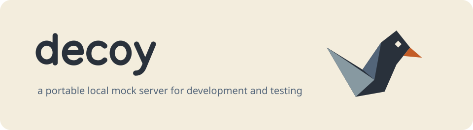
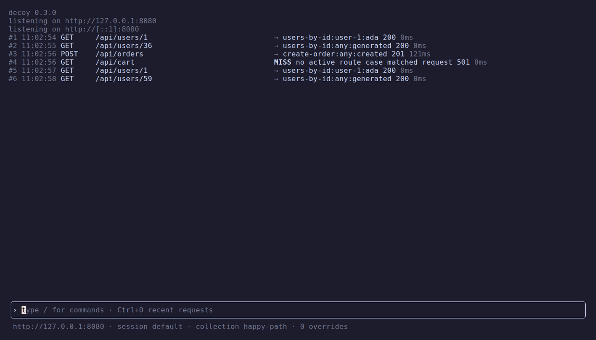

# Decoy

Decoy is a local mock server for HTTP, gRPC, and WebSocket clients. Define your Routes,
point your app at Decoy, and switch the same request from success to failure while the app is
running. When a request misses, Decoy returns a diagnostic. Forwarding to an upstream requires
an explicit Passthrough Behavior.

## Try it

1. [Install Decoy](apps/docs/content/docs/install/index.mdx) as a standalone binary or a dev dependency in your JS project.
2. [Serve your first mock](apps/docs/content/docs/quick-start/index.mdx). Make `GET /users/123` return Ada, then switch it to a 404.
3. [Open the terminal UI](apps/docs/content/docs/tui/index.md) to inspect requests and switch Collections interactively.

## Use it in tests

Parallel tests can share one Decoy server. Each test gets its own Session, so switching a Collection
in one test leaves the others on their own scenarios. The [Playwright fixture](apps/docs/content/docs/playwright/index.mdx)
and [Testplane plugin](apps/docs/content/docs/testplane/index.mdx) manage Sessions for you. Other clients can set the
Session header and call the [Control API](apps/docs/content/docs/sessions-and-control/index.md).

Browse the [user guide](apps/docs/content/docs/index.md) for configuration and transport details, or start
with a [runnable example](examples/README.md).

## Contributing

For local builds and checks, see [Contributing](CONTRIBUTING.md). The [documentation index](docs/README.md) links to the glossary, design records, and maintainer runbook.
